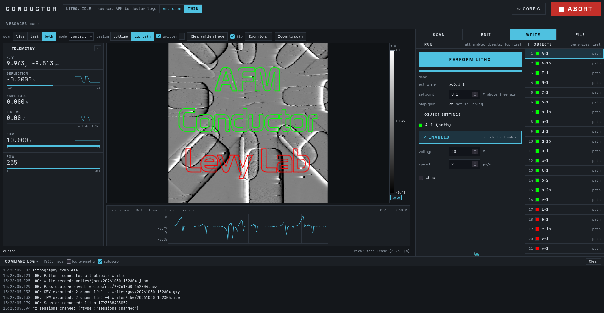

# AFM Conductor

A control and design program for conductive-AFM lithography and scripted AFM experiments.

AFM Conductor brings together multiple aspects of conductive AFM lithography and control into one interface. Scanning, lithography design and write settings, monitoring, and unattended scripting are brought into a single program that is designed for extensibility. Previewing runs on an instrument is available by using a digital twin, which mirrors the AFM to allow users to learn how to use the program, create and edit designs, test scripts before a real run, try write settings, check a design against a scan, and estimate the approximate time an experiment will take, without needing to connect to the physical hardware. Designed to be as realistic as possible, the twin provides users the ability to maximize their instrument time. Additionally, scripting functionality and safety monitoring allow for unattended scripting of AFM experiments through [FLEX: the Framework for Laboratory EXperimentation](https://github.com/levylabpitt/FLEX). AI skills for scripting AFM experiments are available, alongside detailed documentation for the scripting interface if you wish to write your own scripts.
## Features

- Scanning in contact and AC mode
- Design import from SVG and GDS
- Design editing, with write settings for each object
- Writing patterns, including chiral wires
- Live monitoring of the tip and the instrument
- Safety monitoring, including an abort functionality that will put the probe into a safe state if an unsafe state is detected, or if the user presses the abort button
- A digital twin of the AFM
- Scripting through FLEX
- Data saved as `.ibw` and `.npz`
- Journaling of all commands sent to and from the AFM, as well as all interactions with the program. This functionality is recorded in the time based order in which they occur by an independent process.

## Requirements

- Python 3.11 or newer
- Windows or Linux for the digital twin (tested on Windows 11 and Debian with KDE); the instrument PC runs Windows
- For the instrument: Asylum Research AFM (tested on Cypher and MFP-3D) with Igor-based control software
- Optional: KLayout, for importing GDS designs (`uv sync --extra geometry`); FLEX, for scripting

## Installation

### Windows

After cloning the repository into a directory on your computer (`git clone https://github.com/levylabpitt/afm-conductor.git` or by downloading the zip and extracting it), you can run `install-config-conductor.cmd` which will handle the installation of uv, Python, and all of the package dependencies and versions automatically. If you intend to use this for controlling an Asylum AFM running with Igor, then you should also run `install-config-hardware.cmd` after running the first. The second script will install hardware specific dependencies, and configure the Igor installation for communication between Igor and Python.

Note: Asylum often ships their software with Igor version 6.38B01 (the B standing for beta). COM automation, which is necessary to control the instrument from other software outside of Igor, does not work with version 6.38B01. The script will detect the version of Igor installed, and if necessary, prompt you for an automatic exchange of 6.38B01 with the stable version of Igor 6.37. This will install Igor 6.37 (Windows will ask for administrator permission), and then replace the Igor.exe file in the Asylum Research directory with the 6.37 version. The 6.38B01 version is kept in the same directory as `Igor.exe.6.38-backup`, and can be restored by running `undo-igor-swap.cmd`.

To run the program after installation, run `run-digital-twin.cmd` to run the digital twin, or if you are running it on hardware, run `run-hardware-twin.cmd` (make sure that the Asylum software is up and running before running `run-hardware-twin.cmd`). Your browser should open up the window for the UI.

### Linux

On Linux, only the digital twin is able to run because Python initializes the connection with Igor over COM, which is Windows only. Igor is not available for Linux. Follow these steps:

* Install uv: `curl -LsSf https://astral.sh/uv/install.sh | sh`
* Clone the repo: `git clone https://github.com/levylabpitt/afm-conductor.git`
* Go into the folder: `cd afm-conductor`
* Install Python 3.12 and the packages: `uv sync`
* Run `uv run afm-conductor` in the folder.

## Status

This project is still in its early stages, but new features are tested on development branches before they are merged into the main branch. The program is currently in use in Levy Lab, where it is used to design, run and automate conductive-AFM lithography experiments. The digital twin is also used to review designs and simulate experiments ahead of time.

## Contributing

Bug reports, feature requests and suggestions can be made through [GitHub Issues](https://github.com/levylabpitt/afm-conductor/issues).

## Acknowledgements

The hardware install downloads two pieces of third-party software, which are not part of this repository and are covered by their own terms: Igor Pro 6.37 (WaveMetrics) and the SOCKIT Igor extension (hosted by WaveMetrics). The interface uses the Space Grotesk and JetBrains Mono fonts under the SIL Open Font License.

Parts of this code were written with the help of AI coding tools (Claude, Anthropic). All code was reviewed and tested by the authors.

## License

BSD 3-Clause. See [LICENSE](LICENSE).

## Coming soon

- Reviewing previous runs on the digital twin.
